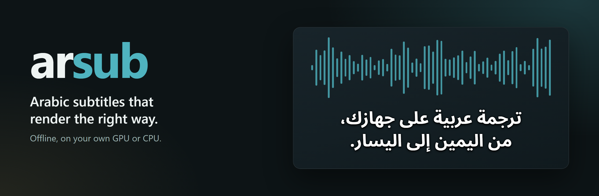
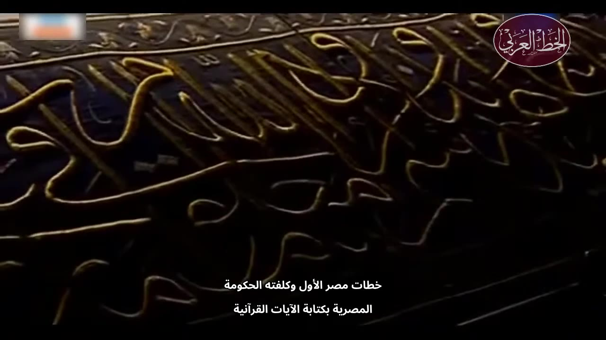
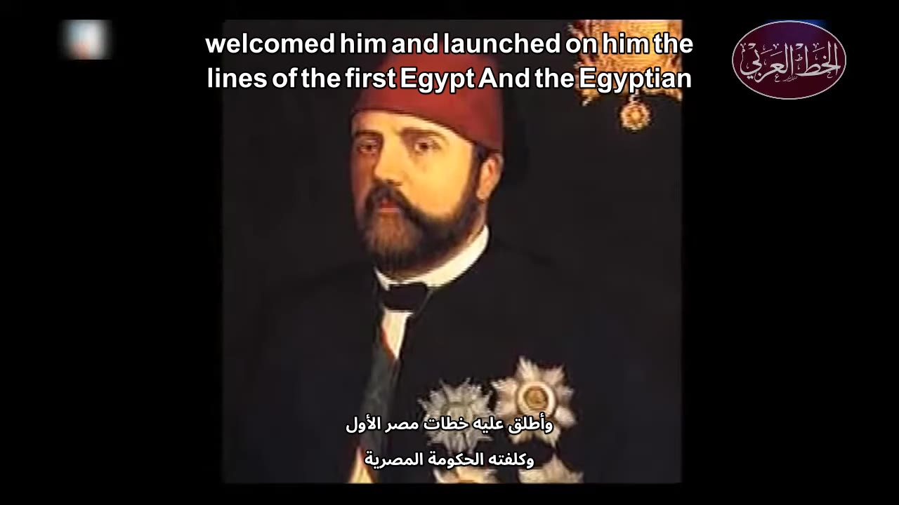
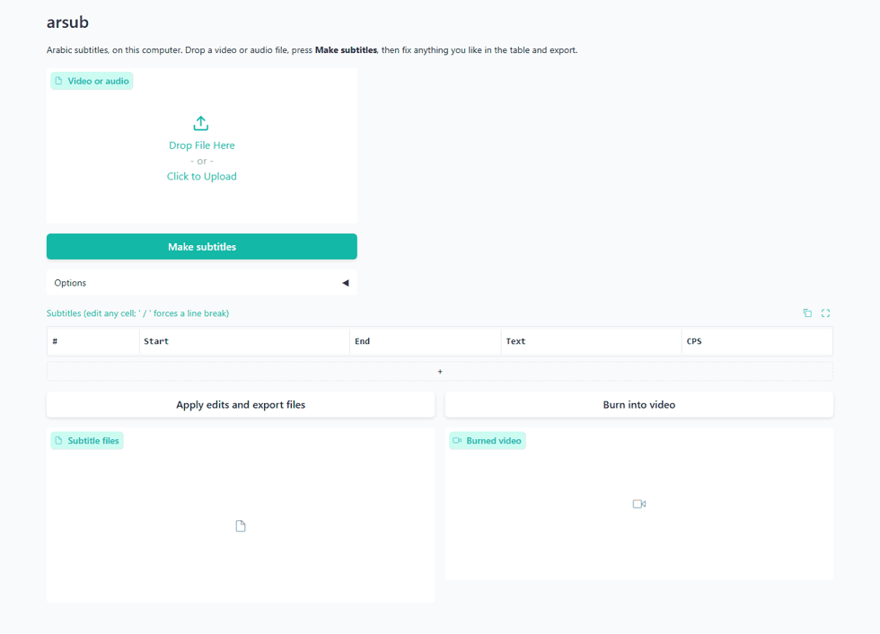
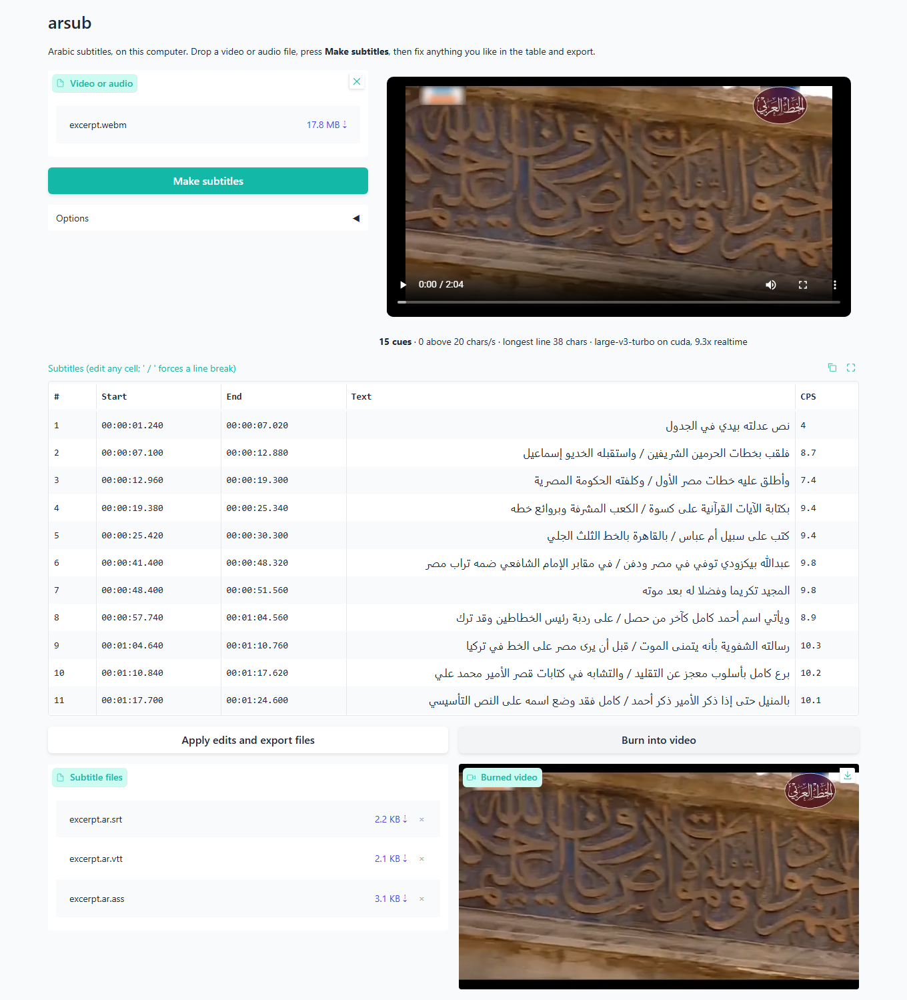
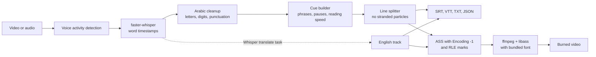

<div align="center">



# arsub

**Drop in a video, get Arabic subtitles that read correctly.**
Offline, on your own GPU or CPU. Nothing is uploaded anywhere.

[](https://www.python.org/)
[](LICENSE)
[](tests)
[](#is-it-really-offline)
[](#install)
[](#why)

</div>

```bash
arsub talk.mp4 --format srt --burn
```

## Start here

| I want to... | Do this |
| --- | --- |
| Get an `.srt` for a video | `arsub talk.mp4` |
| Burn Arabic into the video | `arsub talk.mp4 --burn` |
| Add English subtitles too | `arsub talk.mp4 --translate --burn --burn-track both` |
| Use a page instead of a terminal | `arsub-web`, then drop the file in the browser |
| Turn a voice note into a video | `arsub note.mp3 --burn` |
| Change line length without running the model again | `arsub talk.ar.json --max-chars 36` |
| Fix a word by hand and re-burn | edit the `.srt`, then `arsub talk.mp4 --subs talk.ar.srt --burn` |
| Check my GPU and ffmpeg | `arsub --doctor` |
| See how accurate it really is | [Results](#results) |

## Why

Speech recognition for Arabic is good now. The last mile is not.

Burn an ordinary Arabic `.srt` with plain ffmpeg and this is what you get on the left. The word order of mixed lines is reversed and the punctuation lands on the wrong side, because **libass lays a line out left to right unless the style says `Encoding: -1`**, and a plain `subtitles=` burn never sets it. The bug is in the rendering step, so it survives even when the transcript is perfect.

<p align="center"></p>

*Both columns are real ffmpeg output. Run `python scripts/make_rtl_comparison.py` to regenerate them.*

arsub treats that last mile as the actual product:

- **Rendering that works.** Correct paragraph direction in ASS, RLE and PDF marks around every line in SRT and VTT, and a bundled Arabic font, so a burn does not depend on the fonts installed on your machine.
- **Line breaks an Arabic reader expects.** Lines avoid ending on `في`, `من`, `اللي` or `عشان`, and `عبد الله` or `أبو بكر` stay together. Line length ignores harakat, because they take no width.
- **Reading speed limits.** The defaults follow the [Netflix Arabic style guide](https://partnerhelp.netflixstudios.com/hc/en-us/articles/215517947-Arabic-Timed-Text-Style-Guide): 42 characters per line, two lines, 20 characters per second.
- **Arabic cleanup.** `,` becomes `،` and `?` becomes `؟`, Persian look-alike letters are fixed, and diacritics removal and Arabic-Indic digits are one flag away.
- **Whisper's Arabic ghosts removed.** On near silence, `large-v3-turbo` wrote `ترجمة نانسي قنقر` twice in a test run, a subtitle credit nobody said. arsub drops known lines like that.
- **Honest numbers.** Accuracy below is measured on openly licensed Arabic audio, dialects included, and the script is in the repo.

## Gallery

<table>
<tr>
<td width="50%"></td>
<td width="50%"></td>
</tr>
<tr>
<td width="50%"><sub><code>arsub --burn --batch-size 8</code> on a 28 minute documentary, no manual edits. Errors are left in: the model wrote <code>خطات</code> here where the film says <code>خطاط</code>.</sub></td>
<td width="50%"><sub><code>--translate --burn-track both</code>. The English is a rough gist: "the lines of the first Egypt" should say Egypt's leading calligrapher. See the <a href="#how-good-is-the-english-track">FAQ</a>.</sub></td>
</tr>
</table>

<p align="center"></p>

<p align="center"><sub>The web UI, recorded from a real run on this laptop: upload, transcribe, edit a cue, export, burn.</sub></p>

<details>
<summary>Full screenshot of the editor</summary>


</details>

## Install

Python 3.10 or newer.

```bash
pip install "arsub[web] @ git+https://github.com/Ifazawezk/arabic-subtitles"
```

**NVIDIA GPU (optional, strongly recommended).** arsub finds the CUDA libraries inside your Python environment, so you do not need to install the CUDA toolkit. These two wheels are over 1 GB together:

```bash
pip install nvidia-cublas-cu12 "nvidia-cudnn-cu12>=9,<10"
arsub --doctor
```

**ffmpeg.** Nothing to install. The `imageio-ffmpeg` dependency ships a static build that includes libass, HarfBuzz and FriBidi. To use your own, put it on `PATH` or set `ARSUB_FFMPEG`. Check with `arsub --doctor`.

The first run downloads the model from Hugging Face, once. Every run after that works with the network unplugged.

Tested with faster-whisper 1.2.1, CTranslate2 4.8.4 and an RTX 5050 (Blackwell). PyAV is pinned below 19 because faster-whisper 1.2.1 fails on PyAV 19 with `open() got an unexpected keyword argument 'metadata_errors'`.

## Quick start

```bash
arsub talk.mp4                                  # talk.ar.srt
arsub talk.mp4 -f srt,vtt,ass,txt,json --burn   # every format plus talk.subbed.mp4
arsub talk.mp4 --batch-size 8                   # about 1.5x faster on a GPU
arsub talk.mp4 --digits arabic-indic            # ٢٠٢٦ instead of 2026
arsub talk.mp4 --strip-diacritics --max-chars 36
arsub --help
```

Or start the page:

```bash
arsub-web
```

It opens on `127.0.0.1`. Drop a file, watch the progress bar, edit any cue in the table, export the files or burn the video.

## Results

Measured with `scripts/evaluate.py` on a laptop: RTX 5050 Laptop GPU (8 GB), Intel i9-13900H, Windows 11. Raw data is in [`eval/results.json`](eval/results.json), including what each model wrote for every clip. Method and caveats are in [`docs/benchmarks.md`](docs/benchmarks.md).

**Accuracy and speed on the GPU.** 300 clips, 26.7 minutes of audio. Lower WER and CER are better. Speed is how many seconds of audio are processed per second.

| Model | WER | CER | FLEURS | Common Voice | MASC | MASC clean | MASC noisy | Speed |
| --- | --- | --- | --- | --- | --- | --- | --- | --- |
| small | 30.5% | 9.9% | 25.9% | 34.7% | 33.3% | 27.3% | 39.3% | 20.0x |
| medium | 20.2% | 6.0% | 14.8% | 21.9% | 24.2% | 19.9% | 28.6% | 11.2x |
| **large-v3-turbo** | **15.0%** | **4.8%** | 10.2% | 16.5% | 18.6% | 13.0% | 24.2% | **24.4x** |
| large-v3 | 13.4% | 4.4% | 8.1% | 13.8% | 17.7% | 14.5% | 20.9% | 5.5x |

**On the CPU.** 60 clips, compared with the GPU on the same clips, while the laptop was also doing other work.

| Model | CPU WER | GPU WER | CPU speed | GPU speed |
| --- | --- | --- | --- | --- |
| small | 26.1% | 26.4% | 3.5x | 20.0x |
| medium | 15.3% | 15.0% | 1.1x | 11.7x |
| large-v3-turbo | 10.8% | 10.8% | 1.3x | 24.5x |

**Do the options help?** Same 300 clips, `large-v3-turbo` on the GPU.

| Setting (large-v3-turbo) | WER | CER | MASC WER | Speed |
| --- | --- | --- | --- | --- |
| Default | 15.0% | 4.8% | 18.6% | 24.4x |
| `--batch-size 8` | 15.0% | 5.0% | 18.6% | 31.6x |
| `--dialect msa` | 14.9% | 4.7% | 18.5% | 16.2x |
| `--dialect egyptian` | 14.9% | 4.7% | 18.4% | 15.8x |

**A real film.** The 28 minute documentary from the gallery, narration over music, run through the same code as the `arsub` command. Wall time includes loading the model. The film has no reference transcript, so this table measures speed and subtitle timing, not accuracy.

| Model | Mode | Wall time | Speed | Words | Cues | Over 20 chars/s |
| --- | --- | --- | --- | --- | --- | --- |
| large-v3-turbo | GPU | 58s | 29.3x | 1596 | 164 | 0 |
| large-v3-turbo | GPU, batch 8 | 37s | 46.0x | 1593 | 163 | 0 |
| medium | GPU | 112s | 15.1x | 1589 | 170 | 0 |
| large-v3 | GPU | 126s | 13.5x | 1592 | 167 | 0 |
| small | CPU | 327s | 5.2x | 1604 | 171 | 0 |

What the numbers say:

- **`large-v3-turbo` is the right default on a GPU.** It beats `medium` on accuracy (15.0% against 20.2% WER) and runs 2.2x faster. A 28 minute film took 58 seconds.
- **`large-v3` is the most accurate** at 13.4% WER, and it helps most on noisy audio (20.9% against 24.2%). It is 4.5x slower, and on clean MASC speech turbo actually did better (13.0% against 14.5%).
- **`--batch-size 8` is close to free.** WER stayed at 15.0%, CER moved from 4.8% to 5.0%, and the film went from 29.3x to 46.0x. It is off by default because it needs more GPU memory.
- **`--dialect` is not a dialect switch.** It made no meaningful difference to accuracy (14.9% against 15.0%) and cost about 34% of the speed. See the [FAQ](#how-well-does-it-handle-dialects).
- **The CPU is as accurate as the GPU, just slower.** Same model, same clips, within a point: `small` scored 26.1% on the CPU and 26.4% on the GPU.
- **Noise matters as much as the model.** On MASC, turbo scored 13.0% on clean clips and 24.2% on noisy ones.

These scores use normalized text, explained in [`docs/benchmarks.md`](docs/benchmarks.md), along with the limits of a set this small.

## How it works



1. **Transcribe.** faster-whisper runs on CUDA if it can. On any CUDA failure (missing DLL, out of memory, unsupported card) arsub says why and restarts on the CPU with `small`, unless you forced `--device cuda`.
2. **Clean.** Every word gets letter, digit and diacritic fixes. Stray punctuation joins the word before it.
3. **Group.** Words become cues at pauses and sentence ends. A cue that overflows is cut at the best nearby phrase boundary, not at the exact character limit.
4. **Split lines.** Every word boundary is scored for balance, punctuation and stranded particles, and the cheapest layout wins.
5. **Fix timing.** Cues are extended into the silence after them to reach the reading speed limit. Text never appears before it is spoken.
6. **Render.** ASS gets `Encoding: -1`, RLE and PDF marks, and a font that has Arabic glyphs. ffmpeg runs from a temporary folder, so non-ASCII paths and Windows drive letters cannot break the filter string.

## How it compares

Checked in October 2026 against each project's README and source code. These are good tools, and several are far more mature than arsub.

| | arsub | [Subtitle Edit](https://github.com/SubtitleEdit/subtitleedit) | [Tafrigh](https://github.com/ieasybooks/tafrigh) | [WhisperX](https://github.com/m-bain/whisperX) | [Buzz](https://github.com/chidiwilliams/buzz) | [auto-subtitle](https://github.com/m1guelpf/auto-subtitle) | [SubLab](https://github.com/Hayder-IRAQ/SubLab) |
| --- | --- | --- | --- | --- | --- | --- | --- |
| Offline speech to text | yes | yes | yes, with Whisper | yes | yes | yes | yes |
| Built for Arabic | **yes** | no | **yes** | no | no | no | partly |
| Arabic line break rules | **yes** | not checked | no | width limit only | no | no | not stated |
| Burn-in | yes | yes | no | no | not stated | yes | yes |
| Burn-in sets RTL direction | **yes** | not tested | n/a | n/a | n/a | no | not stated |
| SRT and VTT | yes | yes | yes | yes | yes | SRT only | yes |
| ASS | yes | yes | no | no | no | no | no |
| Translation | English, offline | many, some online | English | English | yes | English | Argos offline or Google online |
| Interface | CLI, web | full desktop editor | CLI | CLI, Python | desktop, CLI | CLI | desktop |
| Arabic benchmark in the repo | **yes** | not found | not found | not found | not found | not found | not found |
| License | MIT | MIT | MIT | BSD-2-Clause | MIT | MIT | CC BY-NC 4.0 |

**Use something else when:**

- You want a complete subtitle editor with waveform, spell check and every format. Use **Subtitle Edit**. It is the most capable tool here, and it also has Whisper, burn-in and right-to-left support, though you drive them yourself.
- You want to transcribe YouTube links or whole playlists, or use wit.ai. Use **Tafrigh**, the closest Arabic-focused project. arsub only takes local files.
- You need speaker labels or tighter word alignment. Use **WhisperX**. It has an Arabic alignment model and speaker diarization.
- You want a polished desktop app for many languages. Use **Buzz**.

## Options that matter

| Option | Default | What it does |
| --- | --- | --- |
| `-m, --model` | `auto` | GPU: `large-v3-turbo`. CPU: `small`. Also `medium`, `large-v3`, or a local model folder |
| `-f, --format` | `srt` | Any of `srt,vtt,ass,txt,json`, or `all` |
| `--burn` | off | Writes `<name>.subbed.mp4` |
| `--burn-track` | `ar` | `ar`, `en` or `both` |
| `--translate` | off | Adds `<name>.en.srt` |
| `--dialect` | `none` | `msa`, `egyptian`, `gulf`, `levantine`, `maghrebi` |
| `--max-chars` | `42` | Characters per line, diacritics not counted |
| `--max-cps` | `20` | Reading speed limit |
| `--digits` | `western` | `western`, `arabic-indic`, `keep` |
| `--strip-diacritics` | off | Removes harakat |
| `--rtl-marks` | `embed` | `embed`, `rlm` or `none`, for `.srt` and `.vtt` |
| `--batch-size` | `0` | Batched GPU inference, for example `8` |
| `--video-codec` | `libx264` | `h264_nvenc` encodes on the GPU |

## Roadmap

- [x] Offline transcription with GPU first and CPU fallback
- [x] Arabic line breaking, reading speed limits, punctuation and digit options
- [x] SRT, VTT, ASS, TXT and JSON
- [x] Burn-in with correct right-to-left rendering
- [x] English translation track
- [x] Local web UI with progress bar and editor
- [x] Public evaluation on openly licensed audio
- [ ] Benchmark per dialect, with labelled data
- [ ] Forced alignment for sharper word timing
- [ ] Arabic-tuned Whisper models as presets
- [ ] Speaker labels and per-speaker colors
- [ ] Offline translation to and from other languages
- [ ] Batch folders and watch mode
- [ ] Windows installer that needs no Python

## FAQ

<details id="is-it-really-offline">
<summary><b>Is it really offline?</b></summary>

Yes, once the model is on disk. The only network use is that first download. You do not have to take that on trust: `python scripts/check_offline.py video.mp4 -m small` runs the real command under an audit hook that records every socket and DNS call, and fails if there are any. The web UI turns Gradio analytics off and uses system fonts. Checked in a real browser: 92 requests on page load, none external.
</details>

<details>
<summary><b>Which model should I use?</b></summary>

With a GPU, keep the default `large-v3-turbo`. If the audio is noisy and you can wait, use `-m large-v3`. Without a GPU, arsub uses `small`, which runs at about 3.5x realtime on the test laptop but makes roughly twice the errors. If you can wait, `-m large-v3-turbo` on a CPU ran at 1.3x and scored 10.8% against 26.1% on the same clips.
</details>

<details id="how-well-does-it-handle-dialects">
<summary><b>How well does it handle dialects?</b></summary>

Less well than formal Arabic. See the MASC column in [Results](#results): it is real YouTube speech, and it scores worse than read text. On one real Egyptian recording, words like `بتاعه` and `هيبقالها` came through with no help at all. `--dialect` primes the model with a sample sentence, but on the test set it changed WER by less than a point (14.9% against 15.0%) and cost about 34% of the speed. On that recording every preset did roughly the same thing: it added punctuation and formal spelling (`لأن` for `لان`), and did not move the text toward a dialect. Treat it as a punctuation option. MASC is not labelled by dialect, so there is no per-dialect score yet, and that is the top item on the roadmap.
</details>

<details id="how-good-is-the-english-track">
<summary><b>How good is the English track?</b></summary>

Good enough to follow along, not good enough to publish. It comes from Whisper's translate task, which writes English directly from the audio. On literary narration it stumbles: one run turned Kufic script into "the simple kufr". Treat it as a rough gist and have a person check anything that matters.

`large-v3-turbo` cannot do this at all. Asked to translate, it returned Arabic, so arsub uses `medium` for the English track when turbo is the main model, and warns if a track still comes back in Arabic. That downloads `medium` once. In a side by side test `large-v3` was not clearly better. Use `--translate-model` to choose.
</details>

<details>
<summary><b>My player shows punctuation on the wrong side of an .srt. What now?</b></summary>

arsub wraps each line in invisible RLE and PDF marks by default, which fixed every case tested through ffmpeg so far. If a TV or player still gets it wrong, try `--rtl-marks rlm`, and please open an issue with the player name.
</details>

<details>
<summary><b>What is Encoding -1?</b></summary>

A field in the ASS style. In [libass](https://github.com/libass/libass/blob/master/libass/ass_shaper.c), `-1` means "detect the paragraph direction" and every other value means left to right. ffmpeg's `subtitles` filter turns an SRT into ASS with a normal encoding value, so Arabic comes out as a left-to-right paragraph. That is the whole bug.
</details>

<details>
<summary><b>Why does the .srt start with a BOM?</b></summary>

Some older Windows players and TVs read UTF-8 without a BOM as a local code page, which turns Arabic into garbage. Modern players ignore it.
</details>

<details>
<summary><b>Does it work on Linux and macOS?</b></summary>

It should, because everything it uses is cross-platform, but all testing so far has been on Windows 11. On macOS it will run on the CPU, since CTranslate2 has no Metal backend for this.
</details>

<details>
<summary><b>Can I use the output commercially?</b></summary>

The code is MIT. The Whisper weights are MIT too, see [Licenses](#licenses). You are responsible for rights in the video you subtitle.
</details>

## Contributing

Bad line breaks, player rendering bugs and openly licensed dialect recordings help the most. See [CONTRIBUTING.md](CONTRIBUTING.md).

## Licenses

| What | License |
| --- | --- |
| arsub code | [MIT](LICENSE), Copyright (c) 2026 Mohaned Elhagar |
| Noto Sans Arabic font (bundled) | [SIL OFL 1.1](src/arsub/fonts/OFL.txt) |
| Whisper model weights (OpenAI) | MIT |
| faster-whisper, CTranslate2 | MIT |
| Silero VAD, inside faster-whisper | MIT |
| ffmpeg in `imageio-ffmpeg` | GPL build, a separate program that arsub calls |
| CUDA libraries (`arsub[gpu]`) | NVIDIA proprietary license, installed by you and not shipped here |

Test audio is not in this repository. [`eval/testset.csv`](eval/testset.csv) lists every clip and its license: [FLEURS](https://huggingface.co/datasets/google/fleurs) (CC BY 4.0), [Common Voice 18](https://huggingface.co/datasets/MohamedRashad/common-voice-18-arabic) (CC0 upstream; these clips come from a third-party mirror, so see [the note](docs/benchmarks.md) before reusing them) and [MASC](https://huggingface.co/datasets/MohamedRashad/MASC-Arabic) (CC BY 4.0).

The burned frames in the gallery come from [*History of Arabic Calligraphy*](https://commons.wikimedia.org/wiki/File:%D9%81%D9%8A%D9%84%D9%85_%D9%88%D8%AB%D8%A7%D8%A6%D9%82%D9%8A_%D8%AA%D8%A7%D8%B1%D9%8A%D8%AE_%D8%A7%D9%84%D8%AE%D8%B7_%D8%A7%D9%84%D8%B9%D8%B1%D8%A8%D9%8A-_%D9%85%D9%84%D8%A7%D9%85%D8%AD_%D9%85%D8%B5%D8%B1%D9%8A%D8%A9.webm) by Hamdy Khwaiter, CC BY 3.0, with subtitles added by arsub.
