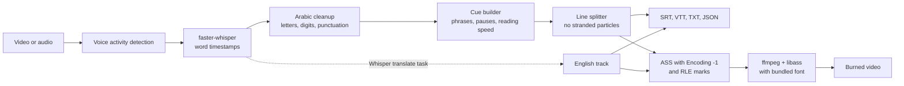

<div align="center">


# arsub

Drop in a video, get Arabic subtitles that read correctly.<br>
Runs offline on your own GPU or CPU, and nothing is uploaded anywhere.

[](https://www.python.org/)
[](LICENSE)
[](#install)

</div>

```bash
arsub talk.mp4 --format srt --burn
```

Speech recognition for Arabic is good now, but the subtitles still tend to break on screen. Burn an ordinary Arabic `.srt` with plain ffmpeg and you get the left column below: mixed lines come out in reverse word order and the punctuation lands on the wrong side. libass lays a line out left to right unless the style says `Encoding: -1`, and a plain `subtitles=` burn never sets it, so the bug survives even a perfect transcript.

<p align="center"></p>

*Both columns are real ffmpeg output. Run `python scripts/make_rtl_comparison.py` to regenerate them.*

`Encoding` is a field in the ASS style. In [libass](https://github.com/libass/libass/blob/master/libass/ass_shaper.c), `-1` means "detect the paragraph direction" and every other value means left to right. ffmpeg's `subtitles` filter turns an SRT into ASS with a normal encoding value, so Arabic comes out as a left-to-right paragraph.

arsub sets the paragraph direction in ASS, puts RLE and PDF marks around every line in SRT and VTT, and bundles an Arabic font, so a burn does not depend on the fonts installed on your machine. It also does the Arabic-specific cleanup around that:

- Lines avoid ending on `في`, `من`, `اللي` or `عشان`, and `عبد الله` or `أبو بكر` stay together. Line length ignores harakat, because they take no width.
- Reading speed limits follow the [Netflix Arabic style guide](https://partnerhelp.netflixstudios.com/hc/en-us/articles/215517947-Arabic-Timed-Text-Style-Guide) by default: 42 characters per line, two lines, 20 characters per second.
- `,` becomes `،` and `?` becomes `؟`, and Persian look-alike letters are fixed. Removing diacritics or switching to Arabic-Indic digits takes one flag.
- Known Whisper ghost lines are dropped. On near silence, `large-v3-turbo` wrote `ترجمة نانسي قنقر` twice in a test run, a subtitle credit nobody said.

## Install

Python 3.10 or newer.

```bash
pip install "arsub[web] @ git+https://github.com/Ifazawezk/arabic-subtitles"
```

An NVIDIA GPU is optional but strongly recommended. arsub finds the CUDA 12 libraries inside your Python environment, so you do not need to install the CUDA toolkit. These two wheels are over 1 GB together:

```bash
pip install nvidia-cublas-cu12 "nvidia-cudnn-cu12>=9,<10"
arsub --doctor
```

There is no ffmpeg to install. The `imageio-ffmpeg` dependency ships a static build that includes libass, HarfBuzz and FriBidi. To use your own, put it on `PATH` or set `ARSUB_FFMPEG`. `arsub --doctor` checks the GPU and ffmpeg.

The first run downloads the model from Hugging Face, once. Every run after that works with the network unplugged. `python scripts/check_offline.py video.mp4 -m small` runs the real command under an audit hook that records every socket and DNS call, and fails if there are any. The web UI turns Gradio analytics off and uses system fonts. Checked in a real browser, page load made 92 requests and none were external.

Tested with faster-whisper 1.2.1, CTranslate2 4.8.4 and an RTX 5050 (Blackwell). PyAV is pinned below 19 because faster-whisper 1.2.1 fails on PyAV 19 with `open() got an unexpected keyword argument 'metadata_errors'`.

## Usage

```bash
arsub talk.mp4                                  # talk.ar.srt
arsub talk.mp4 -f srt,vtt,ass,txt,json --burn   # every format plus talk.subbed.mp4
arsub talk.mp4 --batch-size 8                   # about 1.5x faster on a GPU
arsub talk.mp4 --digits arabic-indic            # ٢٠٢٦ instead of 2026
arsub talk.mp4 --strip-diacritics --max-chars 36
arsub --help
```

A few more:

- `arsub talk.mp4 --burn` burns the Arabic into the video.
- `arsub note.mp3 --burn` turns a voice note into a video.
- `arsub talk.ar.json --max-chars 36` changes the line length without running the model again.
- To fix a word by hand, edit the `.srt` and re-burn with `arsub talk.mp4 --subs talk.ar.srt --burn`.
- `arsub talk.mp4 --translate --burn --burn-track both` adds English subtitles as well.

Two frames from a 28 minute documentary, with no manual edits:

<table>
<tr>
<td width="50%"></td>
<td width="50%"></td>
</tr>
<tr>
<td width="50%"><sub><code>arsub --burn --batch-size 8</code>. Errors are left in: the model wrote <code>خطات</code> here where the film says <code>خطاط</code>.</sub></td>
<td width="50%"><sub><code>--translate --burn-track both</code>. The English is a rough gist: "the lines of the first Egypt" should say Egypt's leading calligrapher.</sub></td>
</tr>
</table>

The English track comes from Whisper's translate task, which writes English straight from the audio. It is good enough to follow along and not good enough to publish. On literary narration it stumbles, and one run turned Kufic script into "the simple kufr", so have a person check anything that matters. `large-v3-turbo` cannot translate at all: asked to, it returned Arabic. When turbo is the main model, arsub uses `medium` for the English track (a one-time download of `medium`) and warns if a track still comes back in Arabic. In a side by side test `large-v3` was not clearly better. `--translate-model` picks the model.

If you would rather use a page than a terminal:

```bash
arsub-web
```

It opens on `127.0.0.1`. Drop a file, watch the progress bar, edit any cue in the table, then export the files or burn the video.

<p align="center"></p>

<p align="center"><sub>Recorded from a real run on this laptop: upload, transcribe, edit a cue, export, burn.</sub></p>

<details>
<summary>Full screenshot of the editor</summary>


</details>

## Options

| Option | Default | What it does |
| --- | --- | --- |
| `-m, --model` | `auto` | GPU: `large-v3-turbo`. CPU: `small`. Also `medium`, `large-v3`, or a local model folder |
| `-f, --format` | `srt` | Any of `srt,vtt,ass,txt,json`, or `all` |
| `--burn` | off | Writes `<name>.subbed.mp4` |
| `--burn-track` | `ar` | `ar`, `en` or `both` |
| `--translate` | off | Adds `<name>.en.srt` |
| `--dialect` | `none` | `msa`, `egyptian`, `gulf`, `levantine`, `maghrebi` |
| `--max-chars` | `42` | Characters per line, diacritics not counted |
| `--max-cps` | `20` | Reading speed limit |
| `--digits` | `western` | `western`, `arabic-indic`, `keep` |
| `--strip-diacritics` | off | Removes harakat |
| `--rtl-marks` | `embed` | `embed`, `rlm` or `none`, for `.srt` and `.vtt` |
| `--batch-size` | `0` | Batched GPU inference, for example `8` |
| `--video-codec` | `libx264` | `h264_nvenc` encodes on the GPU |

The `.srt` starts with a BOM because some older Windows players and TVs read UTF-8 without one as a local code page, which turns Arabic into garbage. Modern players ignore it. The invisible RLE and PDF marks around each line fixed every case tested through ffmpeg so far. If a TV or player still puts punctuation on the wrong side, try `--rtl-marks rlm` and open an issue with the player name.

## Results

Measured with `scripts/evaluate.py` on a laptop with an RTX 5050 Laptop GPU (8 GB), an Intel i9-13900H and Windows 11, using openly licensed Arabic audio with dialects included. Raw data is in [`eval/results.json`](eval/results.json), including what each model wrote for every clip. [`docs/benchmarks.md`](docs/benchmarks.md) has the method, the normalized text the scores use, the CPU runs, the option comparisons, the full film table and the limits of a set this small.

300 clips, 26.7 minutes of audio, on the GPU. Lower WER and CER are better. Speed is how many seconds of audio are processed per second.

| Model | WER | CER | FLEURS | Common Voice | MASC | MASC clean | MASC noisy | Speed |
| --- | --- | --- | --- | --- | --- | --- | --- | --- |
| small | 30.5% | 9.9% | 25.9% | 34.7% | 33.3% | 27.3% | 39.3% | 20.0x |
| medium | 20.2% | 6.0% | 14.8% | 21.9% | 24.2% | 19.9% | 28.6% | 11.2x |
| **large-v3-turbo** | **15.0%** | **4.8%** | 10.2% | 16.5% | 18.6% | 13.0% | 24.2% | **24.4x** |
| large-v3 | 13.4% | 4.4% | 8.1% | 13.8% | 17.7% | 14.5% | 20.9% | 5.5x |

`large-v3-turbo` is the GPU default because it beats `medium` on accuracy (15.0% against 20.2% WER) and runs 2.2x faster. The 28 minute film took 58 seconds. `large-v3` is the most accurate at 13.4% WER and helps most on noisy audio (20.9% against 24.2%), but it is 4.5x slower, and on clean MASC speech turbo did better (13.0% against 14.5%). If the audio is noisy and you can wait, use `-m large-v3`. Noise matters as much as the model: on MASC, turbo scored 13.0% on clean clips and 24.2% on noisy ones.

`--batch-size 8` is close to free. WER stayed at 15.0%, CER moved from 4.8% to 5.0%, and the film went from 29.3x to 46.0x. It is off by default because it needs more GPU memory.

The CPU is as accurate as the GPU, just slower: with the same model on the same clips, `small` scored 26.1% on the CPU and 26.4% on the GPU. Without a GPU arsub uses `small`, which runs at about 3.5x realtime on the test laptop but makes roughly twice the errors. If you can wait, `-m large-v3-turbo` on the CPU ran at 1.3x and scored 10.8% against 26.1% on the same clips.

Dialects do worse than formal Arabic. MASC is real YouTube speech, and it scores worse than read text. On one real Egyptian recording, words like `بتاعه` and `هيبقالها` came through with no help at all. `--dialect` primes the model with a sample sentence, but on the test set it changed WER by less than a point (14.9% against 15.0%) and cost about 34% of the speed. On that recording every preset did roughly the same thing: it added punctuation and formal spelling (`لأن` for `لان`) and did not move the text toward a dialect. Treat it as a punctuation option. MASC is not labelled by dialect, so there is no per-dialect score yet.

## How it works



1. faster-whisper transcribes on CUDA if it can. On any CUDA failure (missing DLL, out of memory, unsupported card) arsub says why and restarts on the CPU with `small`, unless you forced `--device cuda`.
2. Every word gets letter, digit and diacritic fixes, and stray punctuation joins the word before it.
3. Words become cues at pauses and sentence ends. A cue that overflows is cut at the best phrase boundary nearby instead of at the exact character limit.
4. Every word boundary is scored for balance, punctuation and stranded particles, and the cheapest line layout wins.
5. Cues are extended into the silence after them to reach the reading speed limit. Text never appears before it is spoken.
6. ASS gets `Encoding: -1`, RLE and PDF marks, and a font that has Arabic glyphs. ffmpeg runs from a temporary folder, so non-ASCII paths and Windows drive letters cannot break the filter string.

## Other tools

Checked in October 2026 against each project's README and source code. Several of these are far more mature than arsub.

| | arsub | [Subtitle Edit](https://github.com/SubtitleEdit/subtitleedit) | [Tafrigh](https://github.com/ieasybooks/tafrigh) | [WhisperX](https://github.com/m-bain/whisperX) | [Buzz](https://github.com/chidiwilliams/buzz) | [auto-subtitle](https://github.com/m1guelpf/auto-subtitle) | [SubLab](https://github.com/Hayder-IRAQ/SubLab) |
| --- | --- | --- | --- | --- | --- | --- | --- |
| Offline speech to text | yes | yes | yes, with Whisper | yes | yes | yes | yes |
| Built for Arabic | yes | no | yes | no | no | no | partly |
| Arabic line break rules | yes | not checked | no | width limit only | no | no | not stated |
| Burn-in | yes | yes | no | no | not stated | yes | yes |
| Burn-in sets RTL direction | yes | not tested | n/a | n/a | n/a | no | not stated |
| SRT and VTT | yes | yes | yes | yes | yes | SRT only | yes |
| ASS | yes | yes | no | no | no | no | no |
| Translation | English, offline | many, some online | English | English | yes | English | Argos offline or Google online |
| Interface | CLI, web | full desktop editor | CLI | CLI, Python | desktop, CLI | CLI | desktop |
| Arabic benchmark in the repo | yes | not found | not found | not found | not found | not found | not found |
| License | MIT | MIT | MIT | BSD-2-Clause | MIT | MIT | CC BY-NC 4.0 |

Subtitle Edit is the most capable tool here and the one to use for a complete editor with waveform, spell check and every format. It also has Whisper, burn-in and right-to-left support, though you drive them yourself. Tafrigh is the closest Arabic-focused project, and it can transcribe YouTube links, whole playlists or use wit.ai, while arsub only takes local files. WhisperX has an Arabic alignment model and speaker diarization, so use it for speaker labels or tighter word alignment. Buzz is a polished desktop app for many languages.

## Limits and plans

All testing so far has been on Windows 11. Linux and macOS should work, since everything arsub uses is cross-platform, but on macOS it will run on the CPU because CTranslate2 has no Metal backend for this.

Planned, top item first: a benchmark per dialect with labelled data, forced alignment for sharper word timing, Arabic-tuned Whisper models as presets, speaker labels and per-speaker colors, offline translation to and from other languages, batch folders and watch mode, and a Windows installer that needs no Python.

Bad line breaks, player rendering bugs and openly licensed dialect recordings help the most. See [CONTRIBUTING.md](CONTRIBUTING.md).

## Licenses

| What | License |
| --- | --- |
| arsub code | [MIT](LICENSE), Copyright (c) 2026 Mohaned Elhagar |
| Noto Sans Arabic font (bundled) | [SIL OFL 1.1](src/arsub/fonts/OFL.txt) |
| Whisper model weights (OpenAI) | MIT |
| faster-whisper, CTranslate2 | MIT |
| Silero VAD, inside faster-whisper | MIT |
| ffmpeg in `imageio-ffmpeg` | GPL build, a separate program that arsub calls |
| CUDA libraries (`arsub[gpu]`) | NVIDIA proprietary license, installed by you and not shipped here |

For commercial use of the output: the code and the Whisper weights are both MIT, and you are responsible for rights in the video you subtitle.

Test audio is not in this repository. [`eval/testset.csv`](eval/testset.csv) lists every clip and its license: [FLEURS](https://huggingface.co/datasets/google/fleurs) (CC BY 4.0), [Common Voice 18](https://huggingface.co/datasets/MohamedRashad/common-voice-18-arabic) (CC0 upstream; these clips come from a third-party mirror, so see [the note](docs/benchmarks.md) before reusing them) and [MASC](https://huggingface.co/datasets/MohamedRashad/MASC-Arabic) (CC BY 4.0).

The burned frames above come from [*History of Arabic Calligraphy*](https://commons.wikimedia.org/wiki/File:%D9%81%D9%8A%D9%84%D9%85_%D9%88%D8%AB%D8%A7%D8%A6%D9%82%D9%8A_%D8%AA%D8%A7%D8%B1%D9%8A%D8%AE_%D8%A7%D9%84%D8%AE%D8%B7_%D8%A7%D9%84%D8%B9%D8%B1%D8%A8%D9%8A-_%D9%85%D9%84%D8%A7%D9%85%D8%AD_%D9%85%D8%B5%D8%B1%D9%8A%D8%A9.webm) by Hamdy Khwaiter, CC BY 3.0, with subtitles added by arsub.
